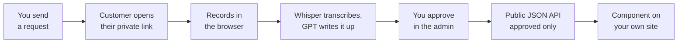

# Video Testimonial Platform

**Testimonials that fill themselves.**

A self-hosted, automated testimonial system. Send a link, your customer records a short video, AI transcribes and writes the testimonial, you approve it, and it renders on your site. You deploy one instance, it exposes a public read-only API, and you drop a component into your own codebase that reads from it. Your content, your database, your domain.

The premise: almost nobody will write you three good paragraphs, but almost everybody will talk to their phone for ninety seconds. So the app asks for a video and does the writing itself.

## How It Works



Only two steps need you: sending the request and approving the result. Everything in between is automatic. The customer never makes an account and never waits on transcription, which runs after their page has already said thank you.

The write-up is three short paragraphs in the customer's own words: the situation before, what changed, and who they'd recommend you to. A text mode is available for people who prefer typing.

- **Only people you invited can submit.** Every request link carries a private token; by default no token means no submission. Set `inviteOnly: false` for a permanently open page.
- **Automatic follow-up.** Unanswered requests get one nudge after seven days, then the app stops.

## Quick Start

```bash
npm install
npm run dev
```

Open `http://localhost:3000`. It works immediately with no configuration — it runs on in-memory demo data, so you can send a request, record, approve, and watch the component update before deciding whether you want any of it. Nothing persists until you add a database.

Make it yours by editing `debrief.config.ts` (brand name, sender, categories, questions, recording-page copy, accent color, invite-only toggle). That one file drives the emails, the recording page, the admin, and the AI prompt.

## The Three Pages

- **`/submit`** — what your customer sees; opens only with their link's token. One question per screen, record in-browser or type.
- **`/admin`** — the whole job in one screen: what's waiting on you, what's live, and who hasn't replied. Approve or delete in one click.
- **`/`** — the instance's own front page, with the testimonial component rendering live below it.

## Putting Testimonials on Your Site

Copy `components/debrief/` into your project, point it at your instance, and render it:

```bash
NEXT_PUBLIC_DEBRIEF_URL=https://testimonials.yourdomain.com
```

```tsx
import TestimonialStrip from '@/components/debrief/TestimonialStrip';
<TestimonialStrip limit={3} heading="What people say" />

import TestimonialWall from '@/components/debrief/TestimonialWall';
<TestimonialWall />  // full stories with video
```

The components are async server components for the Next.js App Router with zero imports from the rest of the repo, so they paste cleanly into any codebase. They're plain Tailwind — restyle freely. They render `null` when there are no approved testimonials.

Prefer to read the API directly?

```
GET https://your-instance/api/public/testimonials?category=consulting&limit=6&featured=true
```

Approved testimonials only, no email addresses, CORS open. The response shape is whitelisted in `lib/public-shape.ts`.

## Going Live

Deploy to Vercel (or anywhere that runs Next.js). Every service is optional and degrades honestly rather than crashing.

| Variable | Without it |
|---|---|
| `NEXT_PUBLIC_APP_URL` | Recording links build against `http://localhost:3000`. |
| `DATABASE_URL` | Runs on in-memory demo data. Any Postgres works. |
| `BLOB_READ_WRITE_TOKEN` | Video upload disabled; recording page switches to text mode. |
| `ADMIN_PASSWORD` | Admin open in dev/demo, locked in a production deploy with a database. |
| `RESEND_API_KEY` + `EMAIL_FROM` | Requests still created; you send the link yourself. |
| `OPENAI_API_KEY` | Videos stored and playable, but not transcribed or written up. |
| `CRON_SECRET` | The nudge endpoint is unauthenticated. Set it. |

With a real database, apply the schema once:

```bash
npm run db:setup
```

The seven-day nudge runs off a daily cron (`vercel.json` already declares it; elsewhere, hit `GET /api/cron/nudges` once a day with `Authorization: Bearer $CRON_SECRET`).

## Wiring It to Your CRM

Three endpoints are the entire integration surface:

| | Endpoint | Auth | Purpose |
|---|---|---|---|
| **Ask** | `POST /api/requests` | Bearer | Fire on your project-closed event. |
| **Track** | `GET /api/requests` | Bearer | Who you've asked and where each stands. |
| **Show** | `GET /api/public/testimonials` | None | Approved results — what your site reads. |

Bearer auth is `Authorization: Bearer $ADMIN_PASSWORD`. The Ask endpoint is idempotent (one open request per email), always returns the recording link, and handles the single automatic follow-up for you.

## Stack

Next.js 16 (App Router) · React 19 · TypeScript · Tailwind v4 · Postgres (plain SQL via postgres.js) · Vercel Blob · Resend · OpenAI Whisper + GPT

## License

MIT — see [LICENSE](LICENSE).
