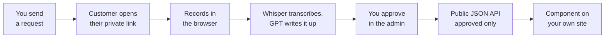

# Video Testimonial Platform

**Testimonials that fill themselves.**

A self-hosted, automated testimonial system. You send a customer a link, they record a short video, AI transcribes it and writes the testimonial, you approve it, and it renders on your own site. You deploy one instance, it exposes a public read-only API, and you drop a zero-dependency component into your codebase that reads from it. Your content, your database, your domain.

## What it is

The premise: almost nobody will write you three good paragraphs, but almost everybody will talk to their phone for ninety seconds. So the app asks for a video and does the writing itself.

Only two steps in the loop need a human — **sending the request** and **approving the result**. Everything in between (recording, upload, transcription, write-up) is automatic. The customer never creates an account, never installs anything, and never waits on transcription, which runs after their page has already said thank you. The generated write-up is three short paragraphs in the customer's own words: the situation before, what changed, and who they'd recommend you to. A text mode exists for people who prefer typing.

## Architecture

### The pipeline



### The three pages

- **`/submit`** — the customer's view; opens only with the private token from their link. One question per screen, record in-browser or type.
- **`/admin`** — the whole job in one screen: what's waiting on you, what's live, and who hasn't replied. Approve, feature, or delete in a click.
- **`/`** — the instance's own front page, with the testimonial component rendering live below it.

### Replaceable seams

Every external dependency is isolated behind a single file, so you can swap any provider without touching the rest of the app:

```
lib/email.ts              # email provider (Resend)      → swap for any mailer
lib/ai.ts                 # transcription + write-up (OpenAI Whisper + GPT)
lib/store.ts              # database access (Postgres)
app/api/upload/route.ts   # blob storage (Vercel Blob)   → swap for S3/R2
lib/public-shape.ts       # whitelist for the public API response
lib/db/schema.sql         # the entire data model: two tables, plain SQL
debrief.config.ts         # brand, questions, categories, copy, accent, invite-only
```

`debrief.config.ts` is the single source of branding — it drives the emails, the recording page, the admin, and the AI prompt. There's no other find-and-replace.

### Integration model (copy a component, not a package)

`components/debrief/` contains async server components for the Next.js App Router with **zero imports from the rest of the repo** — which is exactly what lets them paste cleanly into a stranger's codebase. Point them at your instance with one env var and render:

```tsx
import TestimonialStrip from '@/components/debrief/TestimonialStrip';
<TestimonialStrip limit={3} heading="What people say" />

import TestimonialWall from '@/components/debrief/TestimonialWall';
<TestimonialWall />  // full stories with video, for a /testimonials page
```

They're plain Tailwind (restyle freely) and render `null` when there are no approved testimonials, so you can place them before collecting any. For a non-Next or client-side app, call `fetchTestimonials()` from `debrief-client.ts` and pass the result in via the `testimonials` prop.

### API surface (wire it to your CRM)

Three endpoints are the entire integration surface:

| | Endpoint | Auth | Purpose |
|---|---|---|---|
| **Ask** | `POST /api/requests` | Bearer | Fire on your project-closed event. Idempotent (one open request per email); always returns the recording link; handles the one automatic follow-up. |
| **Track** | `GET /api/requests` | Bearer | Who you've asked and where each stands (`pending` / `completed` / `cancelled`). |
| **Show** | `GET /api/public/testimonials` | None | Approved results only, no email addresses, CORS open — what your site reads. |

Bearer auth is `Authorization: Bearer $ADMIN_PASSWORD`; if that's unset, the two bearer endpoints are switched off entirely. The public read is deliberately open and already safe (approved-only, email stripped via the `public-shape.ts` whitelist).

### Invites & follow-ups

- **Only invited people can submit.** Every request link carries a private token, required by default; submissions with a valid token are flagged **verified**. Set `inviteOnly: false` for a permanently open page.
- **One nudge, then silence.** Unanswered requests get a single automatic nudge after seven days; the counter only advances when the email actually sends, so a mail outage can't silently burn everyone's follow-up.

## What stands out

- **It writes the testimonial for you.** The hard part — turning a rambling 90-second video into three clean paragraphs — is automated via Whisper + GPT, with you as the approval gate.
- **Three files and one env var on your side.** No package to install, no version to keep in step; the components have zero repo-internal imports.
- **Degrades honestly instead of crashing.** With no database it runs on in-memory demo data; with no blob token it switches to text mode; with no AI key it still stores and plays videos. Every missing service is surfaced in plain language, not a stack trace.
- **Your data, your domain.** Self-hosted, public read-only API, Postgres you own — no third-party wall on someone else's domain.
- **Small on purpose.** The whole thing is short enough to read in an afternoon and change in an hour.

## Tech stack

Next.js 16 (App Router) · React 19 · TypeScript · Tailwind v4 · Postgres (plain SQL via postgres.js) · Vercel Blob · Resend · OpenAI Whisper + GPT.

## How to run

### Locally, with zero configuration

```bash
npm install
npm run dev
```

Open `http://localhost:3000`. It works immediately on in-memory demo data — send a request, open the recording page, approve a testimonial, and watch the component update, all before deciding whether you want any of it. Nothing persists until you add a database.

Then make it yours by editing `debrief.config.ts` (brand name, sender, categories, questions, recording-page copy, accent color, invite-only toggle).

### Going live

Deploy to Vercel (or anywhere that runs Next.js) and set what you need — each variable is optional and degrades gracefully:

| Variable | Without it |
|---|---|
| `NEXT_PUBLIC_APP_URL` | Recording links build against `http://localhost:3000`. Set before emailing anyone. |
| `DATABASE_URL` | Runs on in-memory demo data. Any Postgres works (Neon, Supabase, RDS, local). |
| `BLOB_READ_WRITE_TOKEN` | Video upload disabled; recording page switches to text mode. |
| `ADMIN_PASSWORD` | Admin open in dev/demo, locked in a production deploy with a database; also the bearer token for the admin API. |
| `RESEND_API_KEY` + `EMAIL_FROM` | Requests still created; the admin hands you the link to send yourself. |
| `OPENAI_API_KEY` | Videos stored and playable, but not transcribed or written up. |
| `CRON_SECRET` | The nudge endpoint is unauthenticated. Set it. |

With a real database, apply the schema once:

```bash
npm run db:setup   # reads DATABASE_URL and runs lib/db/schema.sql (safe to re-run)
```

The seven-day nudge runs off a daily cron. `vercel.json` already declares it on Vercel; elsewhere, hit `GET /api/cron/nudges` once a day with `Authorization: Bearer $CRON_SECRET`.

## License

MIT — use it commercially, fork it, close-source your fork; just keep the copyright notice. See [LICENSE](LICENSE).
